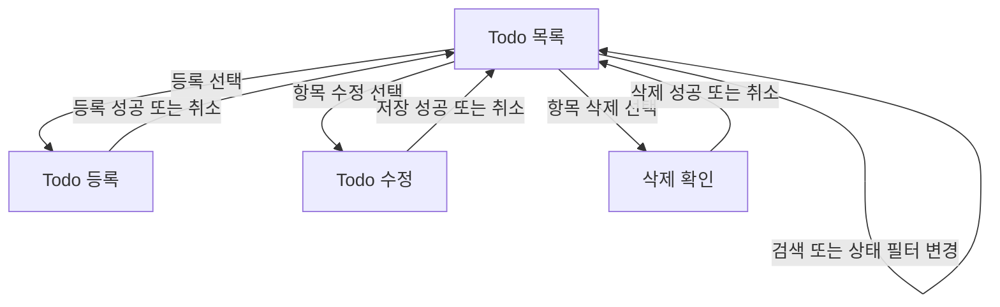

# Todo 화면 흐름

## 화면 목록

| 화면 | 목적 | 주요 동작 |
| --- | --- | --- |
| Todo 목록 | 할 일을 조회하고 관리한다. | 검색, 상태 필터, 완료 상태 변경, 등록·수정 화면 이동, 삭제 확인 열기 |
| Todo 등록 | 새로운 할 일을 작성한다. | 내용 입력, 등록, 취소 |
| Todo 수정 | 기존 할 일을 변경한다. | 기존 내용 확인, 내용 수정, 저장, 취소 |
| 삭제 확인 | 선택한 할 일의 삭제 여부를 확인한다. | 대상 확인, 삭제, 취소 |

## 주요 기능

- Todo 등록
- 완료 상태 변경
- Todo 수정 및 삭제
- 검색 및 상태 필터

## 화면 이동

### Todo 목록

- 각 항목에 내용, 완료 상태, 수정·삭제 동작을 제공한다.
- 완료 상태는 미완료와 완료 사이에서 전환한다.
- 검색은 Todo 내용을 기준으로 수행한다.
- 상태 필터는 전체, 미완료, 완료를 제공하며 기본값은 전체다.
- 검색과 상태 필터는 함께 적용한다. 검색어가 비어 있으면 상태 필터만 적용한다.
- 등록·수정·삭제 후에는 목록에 결과를 반영하고 기존 검색어와 필터를 유지한다.
- 완료 상태 변경으로 항목이 현재 필터와 맞지 않게 되면 목록에서 제외한다.
- Todo가 없는 상태와 검색·필터 결과가 없는 상태를 구분해 안내한다.

### Todo 등록

- Todo 내용을 필수 입력으로 제공한다. 공백만 입력한 경우 등록할 수 없으며 오류를 표시한다.
- 새 Todo는 미완료 상태로 등록한다.
- 등록 성공 시 목록으로 돌아간다. 현재 검색·필터 조건에 맞는 항목만 표시한다.
- 취소 시 입력 내용을 저장하지 않고 목록으로 돌아간다.

### Todo 수정

- 선택한 Todo의 기존 내용을 표시한다.
- 내용 입력 검증은 등록 화면과 동일하게 적용한다.
- 저장 성공 시 수정 내용을 반영하고 목록으로 돌아간다. 완료 상태는 유지한다.
- 취소 시 변경 내용을 저장하지 않고 목록으로 돌아간다.

### 삭제 확인

- 목록에서 여는 확인 대화상자로 제공하며, 삭제할 Todo 내용을 표시한다.
- 삭제 확정 시 해당 항목을 삭제하고 목록에 결과를 반영한다.
- 취소하거나 Escape 키로 닫으면 항목을 유지하고 삭제를 요청한 버튼으로 포커스를 돌린다.
- 대화상자 내부에서 키보드 포커스를 유지한다. 삭제 후에는 다음 항목 또는 목록 제목으로 포커스를 이동한다.

## 화면 크기

| 구분 | 기준 너비 | 배치 원칙 |
| --- | --- | --- |
| Desktop | 1440px | 검색과 상태 필터를 가로로 배치하고 목록의 내용과 항목별 동작을 구분한다. |
| Mobile | 375px | 검색과 필터를 세로로 배치하고 내용을 줄바꿈한다. 항목별 동작은 터치하기 쉽게 배치한다. |

- 두 크기에서 동일한 기능과 화면 흐름을 제공한다.
- 기준 너비 사이에서도 가로 스크롤 없이 반응형으로 동작한다.
- 등록·수정은 모바일에서 단일 열로 구성한다.
- 삭제 확인 대화상자는 화면 양옆 여백을 확보하고 내용이 길면 내부 스크롤을 제공한다.

## 공통 상태

- 처리 중에는 해당 동작의 중복 실행을 방지한다.
- 입력 오류는 해당 필드 가까이에 표시하고 입력 내용을 유지한다.
- 저장·삭제·완료 상태 변경 실패 시 오류와 재시도 방법을 안내하며, 완료되지 않은 작업을 성공으로 표시하지 않는다.
- 데이터 조회가 필요한 경우 로딩, 빈 목록, 조회 실패, 정상 목록 상태를 제공한다.

## 범위

이 문서는 화면과 이동 흐름을 정의한다. 저장 방식, API, 로그인, 마감일, 우선순위는 별도로 정한다.
